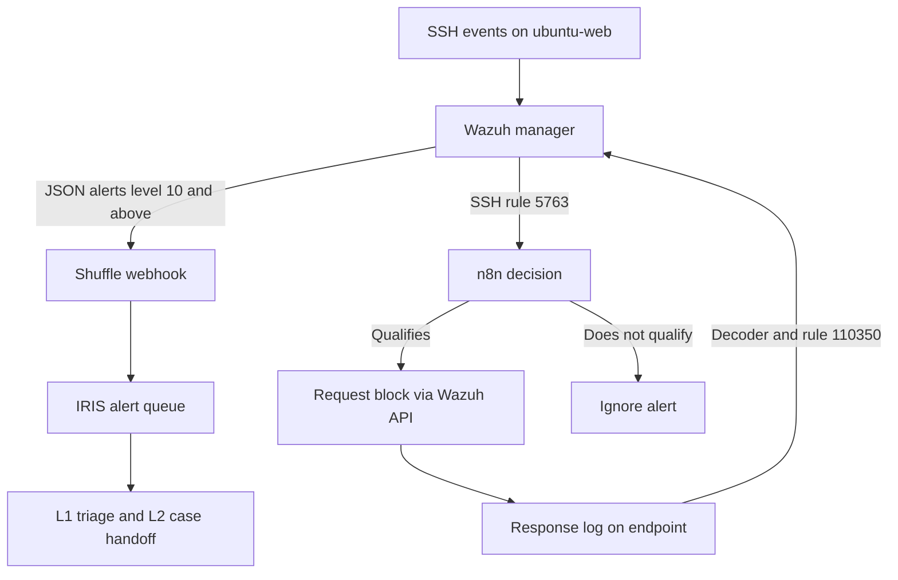

# Alert intake and response paths

Returning a block log to Wazuh makes containment visible in IRIS through the same Shuffle intake. The separate synthetic L1-to-L2 case tested the analyst handoff.
